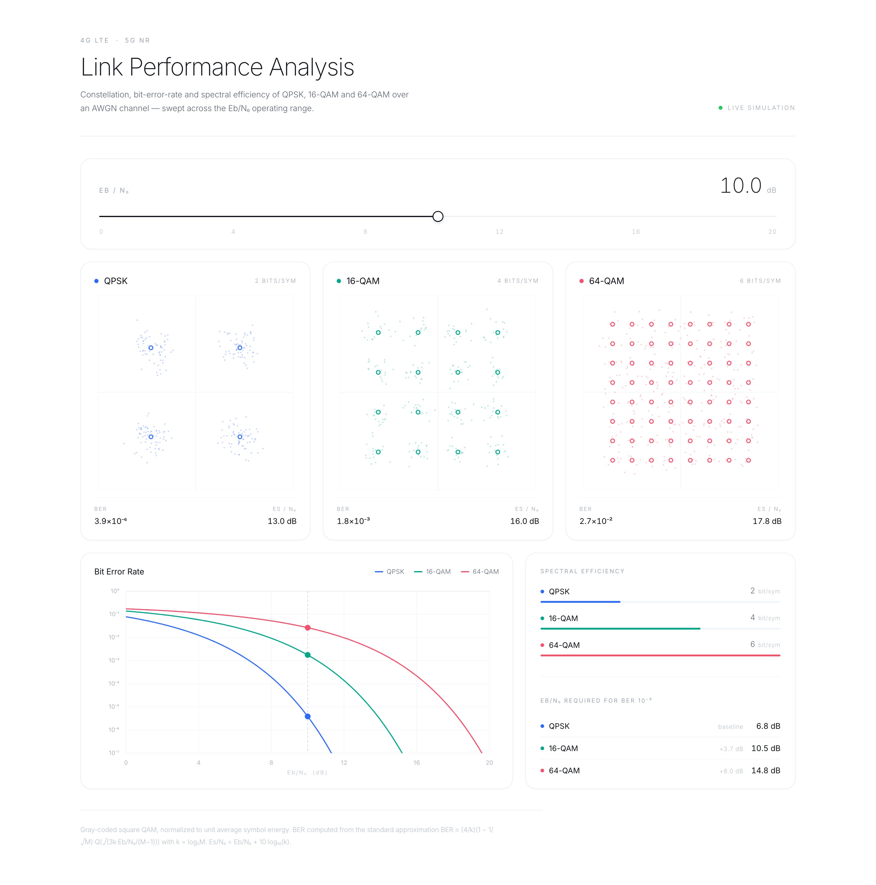
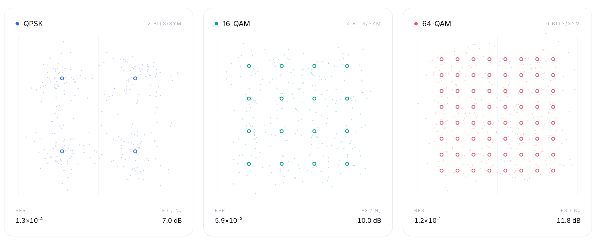
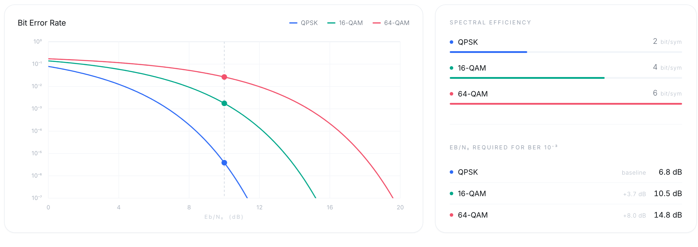

# Link Performance Analysis

**Constellation diagrams, bit-error-rate curves and spectral efficiency for QPSK, 16-QAM and 64-QAM over an AWGN channel.**

**[Open the live demo →](https://abhinav-prabhakar.github.io/CellularAnalysis/)**

[](https://abhinav-prabhakar.github.io/CellularAnalysis/)

## What it does

Drag **Eb/N₀** from 0 to 20 dB and the whole link responds:

- **Live constellations** — 260 received symbols per scheme, redrawn every frame. QPSK holds together; 64-QAM's dense grid smears into noise first.
- **BER curves** — theoretical bit-error rate with a marker that tracks the slider.
- **Link budget readout** — bits/symbol, Es/N₀, and the Eb/N₀ each scheme needs to reach BER 10⁻³.

## Constellations at 4 dB — where the difference shows



## Bit error rate and efficiency at 10 dB



## Model

Gray-coded square QAM normalized to unit average symbol energy:

```
BER ≈ (4/k)(1 − 1/√M) · Q( √( 3k·Eb/N₀ / (M−1) ) )     k = log₂M
Es/N₀ = Eb/N₀ + 10·log₁₀(k)
```

| Scheme | Bits/symbol | Eb/N₀ for BER 10⁻³ |
|:--|:--:|--:|
| QPSK | 2 | 6.8 dB |
| 16-QAM | 4 | 10.5 dB |
| 64-QAM | 6 | 14.8 dB |

## Run it

```bash
git clone https://github.com/Abhinav-Prabhakar/CellularAnalysis
cd CellularAnalysis && open index.html
```

Single file, no build step, no dependencies — plain HTML canvas and vanilla JS. Hosted with GitHub Pages.
